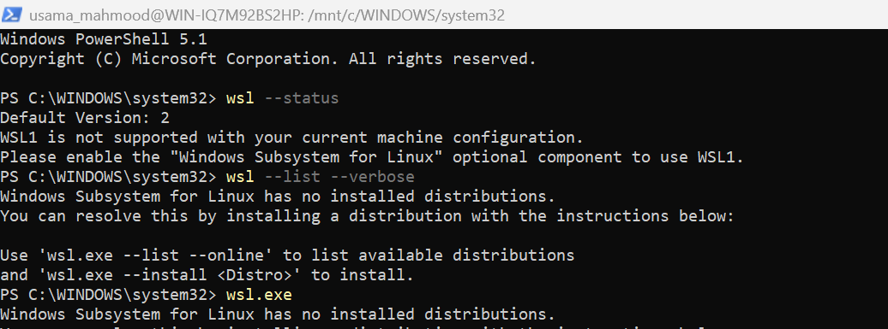
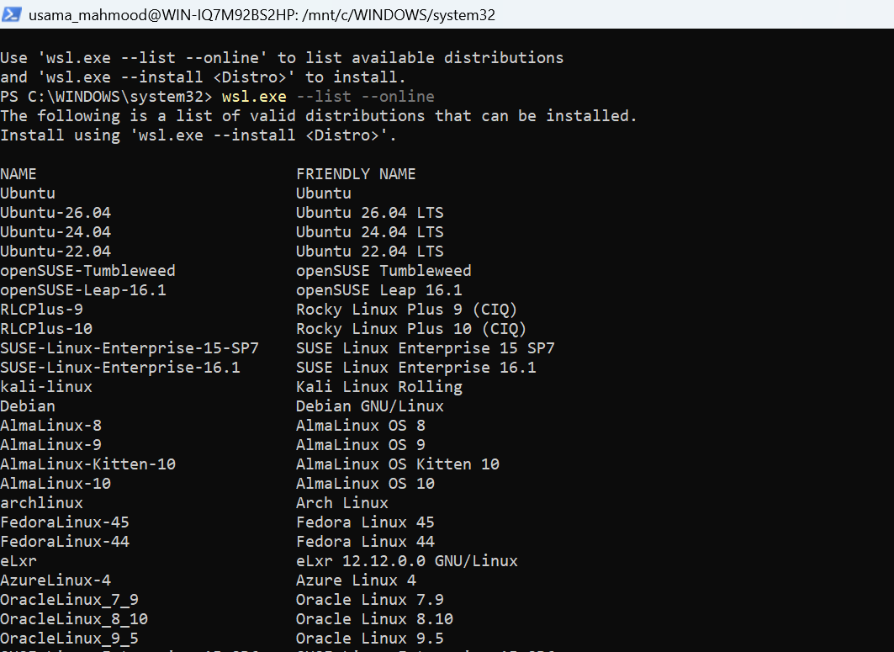
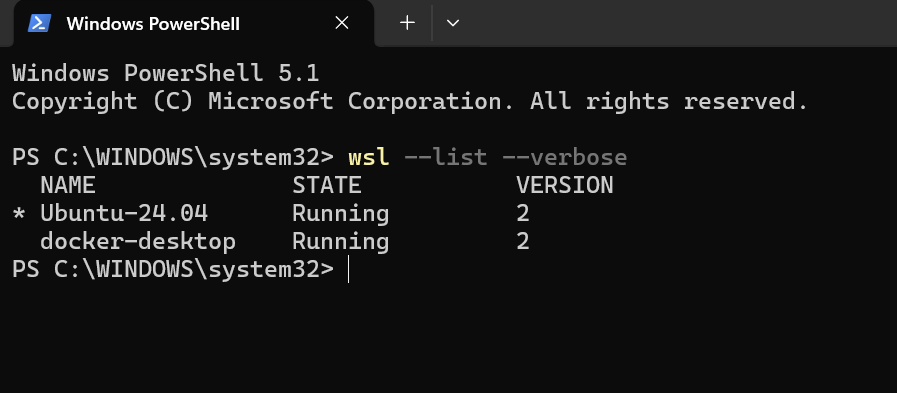
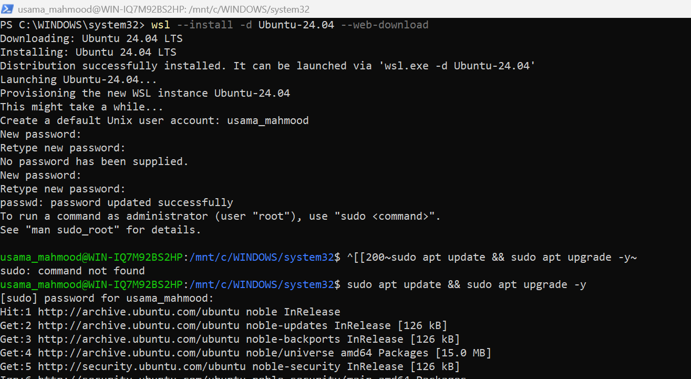
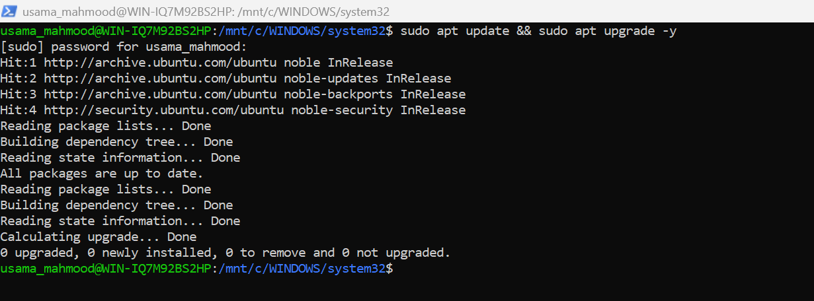
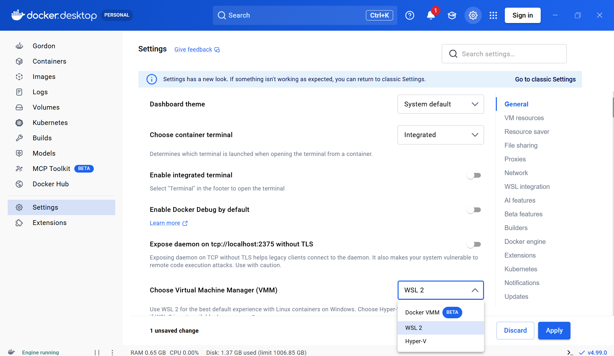
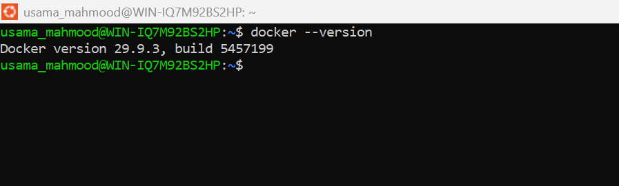
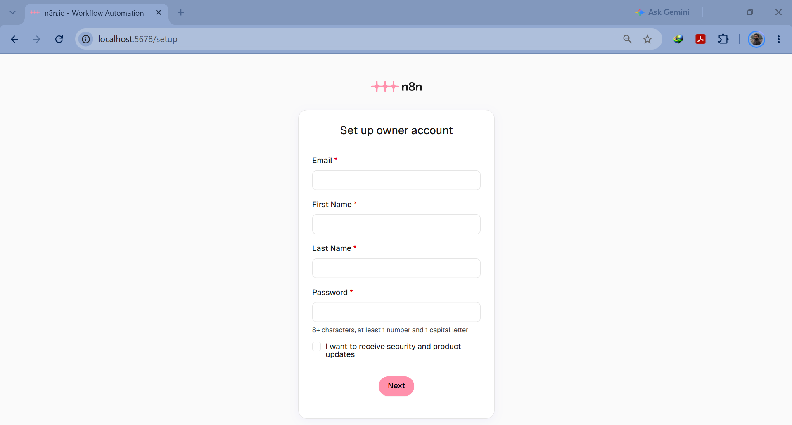

# 🚀 Local n8n Installation on Windows 11 Using WSL 2 and Docker Desktop


A complete, step-by-step guide to installing, configuring, and self-hosting **n8n** locally on **Windows 11** using **Windows Subsystem for Linux (WSL 2)**, **Ubuntu 24.04 LTS**, and **Docker Desktop** with **Docker Compose**.

---

## 📑 Table of Contents

- [📌 Project Overview](#-project-overview)
- [🛠️ Technology Stack](#️-technology-stack)
- [🏗️ System Architecture](#️-system-architecture)
- [📂 Repository Structure](#-repository-structure)
- [1. Enable Windows Subsystem for Linux (WSL 2)](#1-enable-windows-subsystem-for-linux-wsl-2)
- [2. Install Ubuntu 24.04 LTS](#2-install-ubuntu-2404-lts)
- [3. Update Ubuntu Packages](#3-update-ubuntu-packages)
- [4. Install & Configure Docker Desktop on Windows 11](#4-install--configure-docker-desktop-on-windows-11)
- [5. Verify Docker Installation](#5-verify-docker-installation)
- [6. Deploy n8n Using Docker Compose](#6-deploy-n8n-using-docker-compose)
- [7. Access the n8n Dashboard](#7-access-the-n8n-dashboard)
- [8. Useful Docker Commands](#8-useful-docker-commands)
- [9. Troubleshooting](#9-troubleshooting)
- [10. Project Completion Checklist](#10-project-completion-checklist)
- [11. Screenshots Gallery](#11-screenshots-gallery)
- [12. Official Documentation](#12-official-documentation)
- [🏷️ GitHub Topics & Search Keywords](#️-github-topics--search-keywords)

---

## 📌 Project Overview

This repository documents the end-to-end setup of a self-hosted **n8n workflow automation** environment on Windows 11. By running Docker Desktop on top of a **WSL 2 (Ubuntu 24.04 LTS)** backend, n8n achieves native Linux filesystem performance while preserving workflow data across container restarts using persistent Docker volumes.

---

## 🛠️ Technology Stack

| Component | Technology / Version |
| :--- | :--- |
| **Host Operating System** | Windows 11 |
| **Linux Virtualization Layer** | Windows Subsystem for Linux (WSL 2) |
| **Linux Distribution** | Ubuntu 24.04 LTS (Noble Numbat) |
| **Container Engine** | Docker Desktop (WSL 2 Backend) |
| **Container Orchestration** | Docker Compose |
| **Automation Platform** | n8n (`docker.n8n.io/n8nio/n8n:latest`) |

---

## 🏗️ System Architecture

```text
Windows 11 (Host OS)
    │
    ▼
WSL 2 (Virtual Machine Platform)
    │
    ▼
Ubuntu 24.04 LTS (Linux Filesystem: ~/n8n)
    │
    ▼
Docker Desktop (WSL 2 Engine)
    │
    ▼
Docker Container (n8n + n8n_data Persistent Volume)
    │
    ▼
n8n Web Interface ──► http://localhost:5678
```

---

## 📂 Repository Structure

To ensure all screenshots display properly on GitHub, organize your repository files as follows:

```text
local-n8n-windows11-wsl2-docker/
├── README.md
└── screenshots/
    ├── 01-wsl-status.png
    ├── 02-wsl-distributions.png
    ├── 04-ubuntu-terminal.png
    ├── 05-ubuntu-update.png
    ├── 05.1-ubuntu-update.png
    ├── 06-docker-desktop.jpg
    ├── 07-docker-verification.png
    └── 09-n8n-dashboard.png
```

---

## 1. Enable Windows Subsystem for Linux (WSL 2)

WSL 2 allows Linux distributions to run natively alongside Windows 11 without requiring a separate dual-boot setup or heavy traditional virtual machines.

### Step 1.1: Open PowerShell as Administrator
1. Open the **Windows Start** menu.
2. Search for **PowerShell**.
3. Right-click **Windows PowerShell** and select **Run as administrator**.

### Step 1.2: Check WSL Status & Installed Distributions
Run the following commands to verify the default WSL version and check if any distributions are installed:

```powershell
wsl --status
wsl --list --verbose
```

If WSL 2 is not set as your default version, run:

```powershell
wsl --set-default-version 2
```



### Step 1.3: List Available Linux Distributions
View all valid Linux distributions available for installation:

```powershell
wsl --list --online
```



---

## 2. Install Ubuntu 24.04 LTS

Ubuntu 24.04 LTS is used as the Linux environment for running Docker containers efficiently.

### Step 2.1: Install Ubuntu via PowerShell
Run the installation command in PowerShell:

```powershell
wsl --install -d Ubuntu-24.04
```

> **Tip:** If the Microsoft Store download stalls or gets stuck, press `Ctrl + C` to cancel and install directly via web download:
> ```powershell
> wsl --install -d Ubuntu-24.04 --web-download
> ```

### Step 2.2: Create a Linux Unix User Account
Once installation completes, Ubuntu launches automatically and prompts you to create a default Unix username and password:

```text
Create a default Unix user account: your_username
New password: your_password
Retype new password: your_password
```

> **Note:** Linux terminals do not display characters or asterisks while you type your password. This is normal security behavior.



### Step 2.3: Verify Ubuntu Installation
Confirm that Ubuntu 24.04 is running under **WSL version 2**:

```powershell
wsl --list --verbose
```

Expected output:

```text
NAME            STATE           VERSION
Ubuntu-24.04    Running         2
```

---

## 3. Update Ubuntu Packages

After setting up your Ubuntu user, update the package index and upgrade pre-installed system packages.

### Step 3.1: Open Ubuntu Terminal
Launch **Ubuntu 24.04** from the Windows Start menu (or continue directly in the newly provisioned terminal).

### Step 3.2: Update and Upgrade Packages
Run the update and upgrade commands together:

```bash
sudo apt update && sudo apt upgrade -y
```

*Package list update and download in progress:*



*Package upgrade completed:*



### Step 3.3: Verify Ubuntu Release Version
Confirm your Ubuntu version:

```bash
lsb_release -a
```

Expected operating system: `Ubuntu 24.04 LTS`.

---

## 4. Install & Configure Docker Desktop on Windows 11

Docker Desktop provides the Docker Engine, CLI, and Docker Compose tools seamlessly integrated with WSL 2.

### Step 4.1: Download Docker Desktop
1. Visit the official Docker website: [https://www.docker.com/products/docker-desktop/](https://www.docker.com/products/docker-desktop/)
2. Download **Docker Desktop for Windows (AMD64 / ARM64)**.

### Step 4.2: Install Docker Desktop
1. Run the downloaded `Docker Desktop Installer.exe`.
2. Ensure the **Use WSL 2 instead of Hyper-V** option is selected when prompted.
3. Complete the installation wizard and restart Windows if prompted.

### Step 4.3: Configure Docker Desktop VMM & WSL 2 Engine
1. Open **Docker Desktop**.
2. Go to **Settings** (gear icon) → **General**.
3. Under **Choose Virtual Machine Manager (VMM)** (or WSL 2 engine settings), select **WSL 2** and click **Apply**.



### Step 4.4: Enable Ubuntu-24.04 WSL Integration
1. Navigate to **Settings** → **Resources** → **WSL integration**.
2. Toggle ON **Enable integration with my default WSL distro**.
3. Toggle ON **Ubuntu-24.04**.
4. Click **Apply & Restart**.

---

## 5. Verify Docker Installation

Open your **Ubuntu 24.04** terminal and verify that the Docker CLI and Docker Compose are accessible inside WSL:

```bash
# Check installed Docker version
docker --version

# Check Docker Compose version
docker compose version

# Run a test container to confirm engine connectivity
docker run hello-world
```



---

## 6. Deploy n8n Using Docker Compose

Using Docker Compose makes it easy to manage n8n configuration, timezone settings, and persistent storage.

### Step 6.1: Create a Project Directory in Linux Filesystem
Open Ubuntu and create a dedicated folder inside your Linux home directory (`~`):

```bash
cd ~
mkdir n8n
cd n8n
```

> **Performance Best Practice:** Always store Docker project files inside the Linux filesystem (`~/n8n`) rather than `/mnt/c/...` for significantly faster file I/O performance.

### Step 6.2: Create the `docker-compose.yml` File
Create and open the configuration file using `nano`:

```bash
nano docker-compose.yml
```

Paste the following YAML configuration (adjust `TZ` and `GENERIC_TIMEZONE` to your local timezone if needed):

```yaml
services:
  n8n:
    image: docker.n8n.io/n8nio/n8n:latest
    container_name: n8n
    restart: unless-stopped
    ports:
      - "5678:5678"
    environment:
      - TZ=Asia/Karachi
      - GENERIC_TIMEZONE=Asia/Karachi
      - N8N_ENFORCE_SETTINGS_FILE_PERMISSIONS=true
      - N8N_RUNNERS_ENABLED=true
    volumes:
      - n8n_data:/home/node/.n8n

volumes:
  n8n_data:
```

Save and exit `nano`:
1. Press `Ctrl + O` to write the file.
2. Press `Enter` to confirm the filename.
3. Press `Ctrl + X` to exit the editor.

### Step 6.3: Start the n8n Container
Pull the latest n8n image and start the container in detached mode:

```bash
docker compose up -d
```

### Step 6.4: Verify Running Container & Logs
Check that the `n8n` container is up and running:

```bash
docker ps
```

View live startup logs:

```bash
docker compose logs -f n8n
```

*(Press `Ctrl + C` to exit the log view—your n8n container will continue running in the background.)*

---

## 7. Access the n8n Dashboard

1. Open your web browser and navigate to:
   ```text
   http://localhost:5678
   ```
2. Complete the **Set up owner account** form (Email, First Name, Last Name, and Password) and click **Next**.
3. You are now ready to build and test local automation workflows in n8n!



---

## 8. Useful Docker Commands

| Command | Purpose |
| :--- | :--- |
| `docker ps` | List currently running containers |
| `docker ps -a` | List all containers (running and stopped) |
| `docker compose up -d` | Start n8n in detached background mode |
| `docker compose down` | Stop and remove the n8n container (preserves volume data) |
| `docker compose restart` | Restart the running n8n container |
| `docker compose logs -f n8n` | Stream live logs from the n8n container |
| `docker compose pull` | Pull the latest `n8n` Docker image |

> **⚠️ Data Safety Warning:** Your workflows, credentials, and settings are stored in the `n8n_data` Docker volume. Running `docker compose down` stops the container safely without deleting your workflows. **Never** run `docker compose down -v` unless you intentionally want to wipe all stored n8n data.

---

## 9. Troubleshooting

<details>
<summary><strong>WSL does not show Ubuntu-24.04</strong></summary>

1. List available online distributions:
   ```powershell
   wsl --list --online
   ```
2. Install Ubuntu 24.04 using the web download flag:
   ```powershell
   wsl --install -d Ubuntu-24.04 --web-download
   ```
</details>

<details>
<summary><strong><code>docker: command not found</code> inside Ubuntu</strong></summary>

1. Ensure **Docker Desktop** is running on Windows 11.
2. Open **Settings → General** and verify **WSL 2** is selected as the Virtual Machine Manager / engine.
3. Open **Settings → Resources → WSL integration** and ensure **Ubuntu-24.04** is toggled **ON**.
4. Click **Apply & Restart** and reopen your Ubuntu terminal.
</details>

<details>
<summary><strong><code>http://localhost:5678</code> does not load in the browser</strong></summary>

1. Check if the container is running:
   ```bash
   docker ps
   ```
2. Inspect container logs for startup errors:
   ```bash
   docker compose logs -f n8n
   ```
3. Make sure no other local application is occupying port `5678`.
</details>

---

## 10. Project Completion Checklist

- [x] Enable WSL 2 on Windows 11
- [x] Install Ubuntu 24.04 LTS via WSL 2
- [x] Create Linux Unix username and password
- [x] Update and upgrade Ubuntu packages
- [x] Install Docker Desktop on Windows 11
- [x] Configure Docker Desktop with WSL 2 backend & Ubuntu integration
- [x] Verify Docker CLI installation in Ubuntu
- [x] Create `docker-compose.yml` configuration with persistent volume
- [x] Start the n8n container via Docker Compose
- [x] Access the n8n dashboard at `http://localhost:5678`
- [x] Complete initial n8n owner account setup

---

## 11. Screenshots Gallery

| Step | Screenshot File | Description |
| :--- | :--- | :--- |
| **1.2** | [`01-wsl-status.png`](screenshots/01-wsl-status.png) | Checking WSL 2 default version and distribution status in PowerShell |
| **1.3** | [`02-wsl-distributions.png`](screenshots/02-wsl-distributions.png) | Listing available Linux distributions via `wsl --list --online` |
| **2.2** | [`04-ubuntu-terminal.png`](screenshots/04-ubuntu-terminal.png) | Installing Ubuntu 24.04 LTS and configuring the default Unix user |
| **3.2** | [`05-ubuntu-update.png`](screenshots/05-ubuntu-update.png) | Running `sudo apt update && sudo apt upgrade -y` in Ubuntu |
| **3.2** | [`05.1-ubuntu-update.png`](screenshots/05.1-ubuntu-update.png) | Completed Ubuntu package update and upgrade verification |
| **4.3** | [`06-docker-desktop.jpg`](screenshots/06-docker-desktop.jpg) | Configuring Docker Desktop to use the WSL 2 Virtual Machine Manager |
| **5.0** | [`07-docker-verification.png`](screenshots/07-docker-verification.png) | Verifying Docker CLI installation inside the Ubuntu terminal |
| **7.0** | [`09-n8n-dashboard.png`](screenshots/09-n8n-dashboard.png) | Accessing the local n8n setup screen at `http://localhost:5678` |

---

## 12. Official Documentation

- **Microsoft WSL Installation Guide:** [https://learn.microsoft.com/en-us/windows/wsl/install](https://learn.microsoft.com/en-us/windows/wsl/install)
- **Ubuntu Official Downloads:** [https://ubuntu.com/download/desktop](https://ubuntu.com/download/desktop)
- **Docker Desktop for Windows:** [https://docs.docker.com/desktop/setup/install/windows-install/](https://docs.docker.com/desktop/setup/install/windows-install/)
- **Docker WSL 2 Backend:** [https://docs.docker.com/desktop/features/wsl/](https://docs.docker.com/desktop/features/wsl/)
- **n8n Documentation:** [https://docs.n8n.io/](https://docs.n8n.io/)
- **n8n Docker Compose Setup:** [https://docs.n8n.io/hosting/installation/server-setups/docker-compose/](https://docs.n8n.io/hosting/installation/server-setups/docker-compose/)

---

## 🏷️ GitHub Topics & Search Keywords

To maximize discoverability on GitHub, click the **⚙️ gear icon** next to **About** on your repository's main page and add these **Topics**:

```text
n8n, wsl2, windows-11, ubuntu-24-04, docker, docker-desktop, docker-compose, workflow-automation, self-hosted, local-development, automation, devops
```

---

## Conclusion

This guide demonstrates how to set up a clean, production-grade local automation environment on Windows 11 using **WSL 2**, **Ubuntu 24.04 LTS**, **Docker Desktop**, and **n8n**. It provides a reliable foundation for building workflow automations, testing API integrations, and developing self-hosted solutions locally.

**Project Status:** Completed & Verified ✅